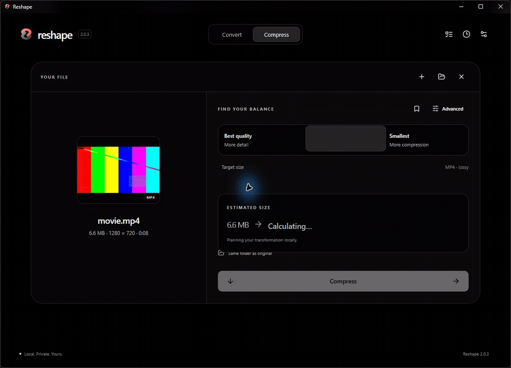
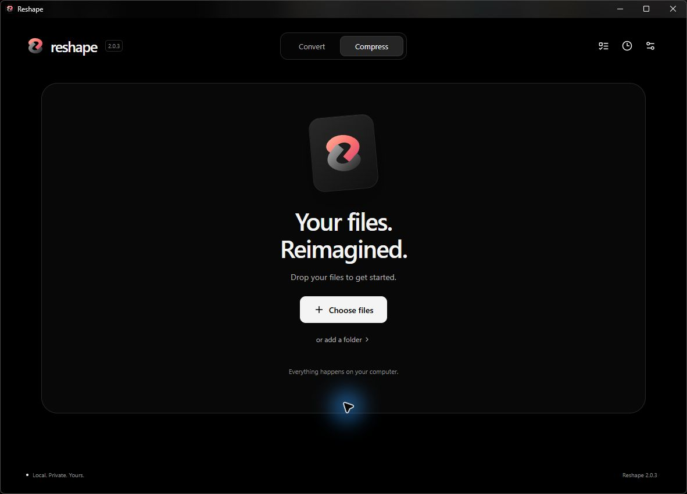
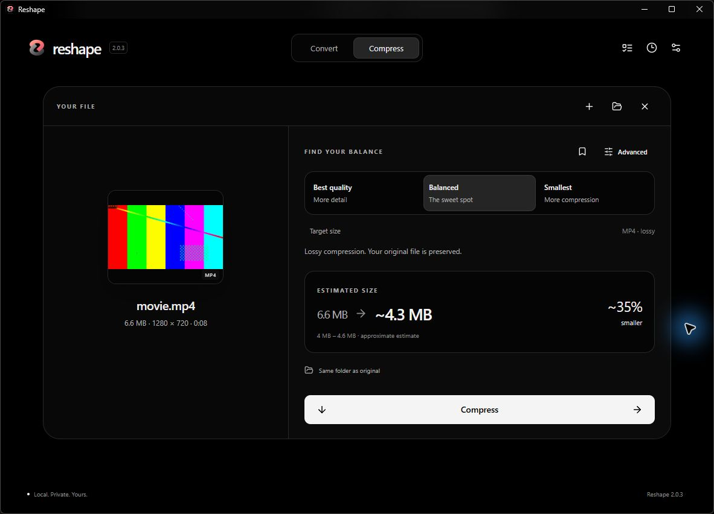
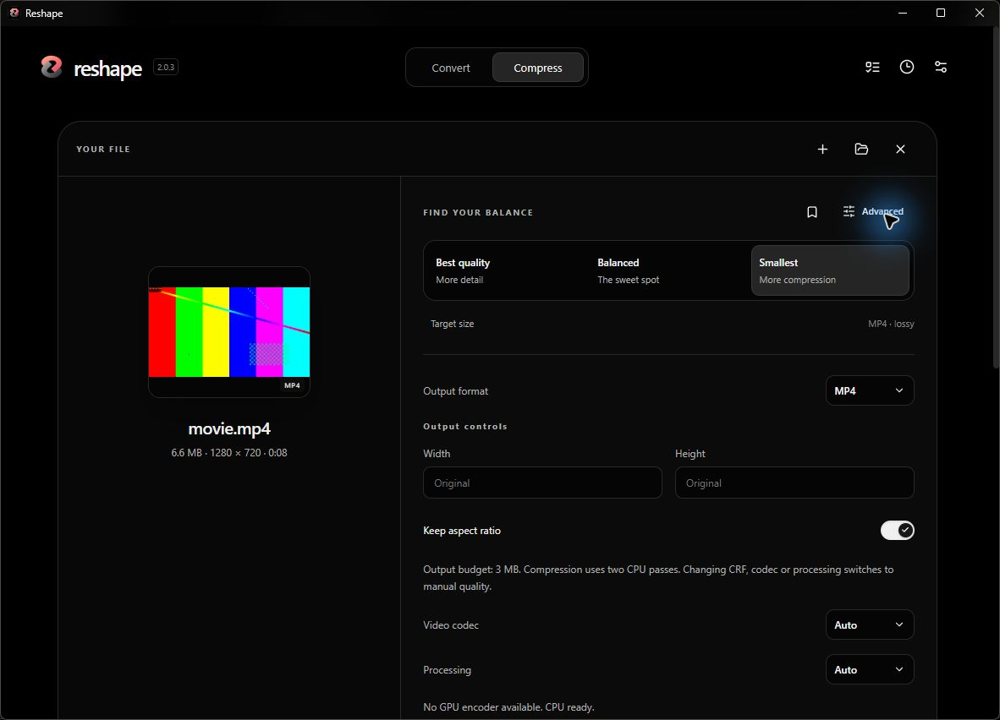
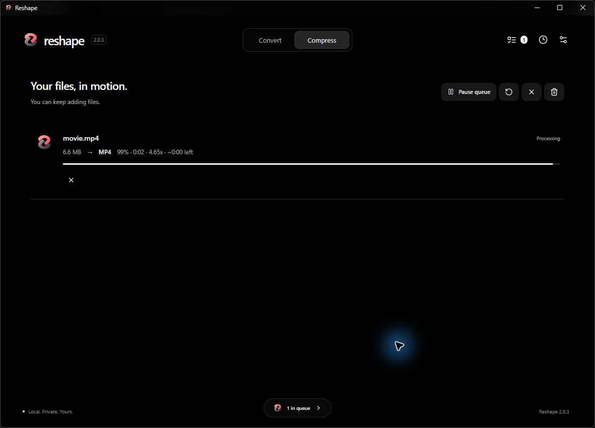
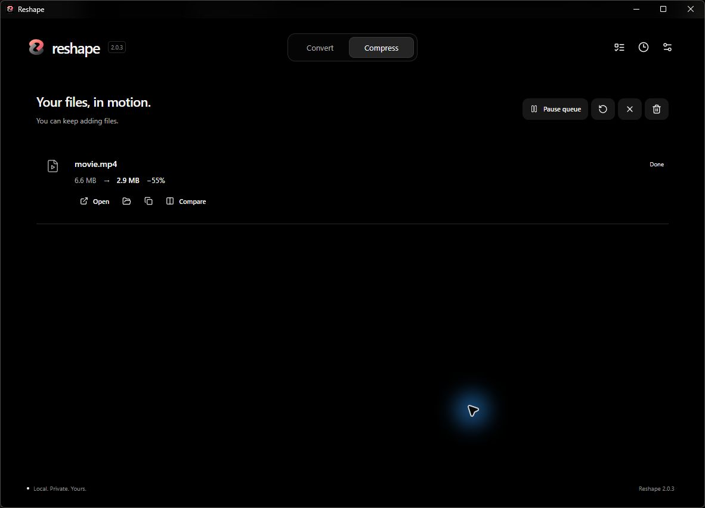
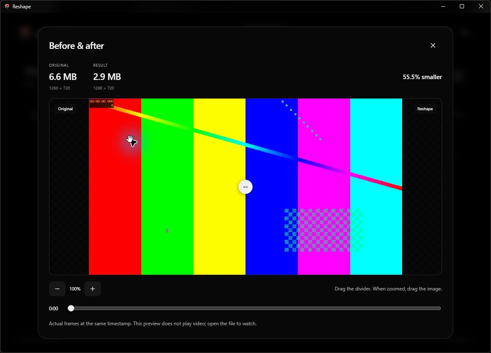

<p align="center"></p>
<h1 align="center">Reshape</h1>
<p align="center"><strong>Convert it. Compress it. Keep the good stuff.</strong></p>
<p align="center">A file converter and compressor for Windows.<br>Drop a file in, choose what you want, and keep creating.</p>
<p align="center"><a href="https://github.com/LASTKING12093/reshape/releases/latest/download/Reshape-Setup-2.0.4.exe"><strong>Download for Windows</strong></a> · <a href="https://github.com/LASTKING12093/reshape/releases/latest">Release notes</a></p>
<p align="center"><a href="https://github.com/LASTKING12093/reshape/actions/workflows/ci.yml"></a> <a href="LICENSE"></a></p>

## Demo



A real recording of the Windows app. The size reduction shown is an example, not a promise for every file.

## Download

Download **[Reshape-Setup-2.0.4.exe](https://github.com/LASTKING12093/reshape/releases/latest/download/Reshape-Setup-2.0.4.exe)** and run it. You want the installer, not GitHub's source-code ZIP.

Windows x64. English by default; Portuguese is available in Settings. Setup downloads the processing engines from their suppliers and verifies their pinned SHA-256 hashes. Allow up to 824 MB of downloads and 6 GB of free space for installation. The installer is currently unsigned; Windows may show an unknown-publisher warning. Checksums are included in the release.

## What can Reshape do?

### Convert

Move between video, audio, image, document and archive formats without learning a collection of command-line tools. Outputs get new names, so your originals stay yours.

### Compress

Pick **Best quality** to favor detail, **Balanced** for a middle ground, or **Smallest** when space matters most. Check the estimate, then see the actual result. Estimates are not guarantees. If compression does not make the file smaller, Reshape keeps the original.

### Advanced when you need it

Codec, bitrate, resolution, frame rate and other relevant controls are one click away. Lossless and lossy options are labeled so you can choose the tradeoff.

### Batch processing

Add several files, pause or cancel work, and inspect each result. Videos run one at a time to keep resource use predictable.

### Compare

Check images and synchronized video frames before and after. Video comparison uses still frames, not simultaneous playback.

### Local processing

Your files are processed on your machine. Setup uses the internet to download the processing engines. Reshape has no cloud conversion service or analytics integration; preferences, optional history and temporary previews stay local.

## Supported formats

Common workflows include MP4/WebM, WAV/FLAC/MP3, PNG/JPEG/WebP, office documents to PDF, Markdown to HTML, and ZIP/7z archives. Outputs depend on the input and selected operation.

See the [format matrix](SUPPORTED_FORMATS.md) and [known limitations](KNOWN_LIMITATIONS.md). Some files are already compact, document layouts can change, and lossy compression can discard detail.

## Screenshots

<table>
<tr><td><br>Start with a file</td><td><br>Find your balance</td></tr>
<tr><td><br>A little more control</td><td><br>Watch the progress</td></tr>
<tr><td><br>See the result</td><td><br>Check the difference</td></tr>
</table>

## Building from source

Windows x64, Node.js 22+, Rust's MSVC toolchain, and Visual Studio Build Tools with the C++ desktop workload and Windows SDK are required.

```powershell
npm ci
powershell -ExecutionPolicy Bypass -File scripts/prepare-engines.ps1
npm run tauri -- dev
```

See [BUILD.md](BUILD.md) for production packaging.

## Contributing

Found a rough edge? Small fixes and clear bug reports are welcome. Start with [CONTRIBUTING.md](CONTRIBUTING.md), and use synthetic files when sharing a reproduction.

## Security

Please report vulnerabilities privately. See [SECURITY.md](SECURITY.md) and the [release audit](docs/ONLINE_RELEASE_AUDIT.md).

## License

Reshape's original code and branding use the [MIT License](LICENSE). FFmpeg, LibreOffice, ImageMagick, Pandoc, Poppler, QPDF and 7-Zip are independent projects with their own licenses. The online installer downloads them directly from suppliers; this repository's release assets do not bundle them. See [third-party notices](THIRD_PARTY_NOTICES.md) and [license details](THIRD_PARTY_LICENSES.md).
